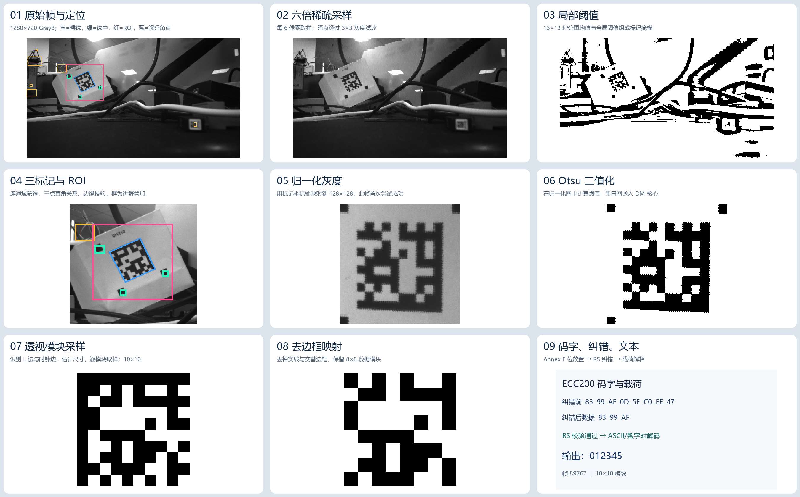

# OV9281 DataMatrix 解码路径与耗时

## 实际路径

当前 `sdkconfig` 设置 `CONFIG_XCR_DATAMATRIX_ONLY=y`，没有启用 `CONFIG_XCR_DATAMATRIX_LIBDMTX`。因此运行的是项目内的外部三标记定位 + 自有 ECC200 解码器，不是 libdmtx。OV9281 的 1280×720 Gray8 帧在 Core 0 采集，经只保留最新帧的队列交给 Core 1；当前实时固件由 Core 0/1 并行搜索左右区域的外部标记，Core 1 后续解码并精修角点。帧龄上限是 100 ms。入口见 `port/standalone_idf_test/main/agv_pipeline.c`、`port/components/xcr_decoder/src/xcr_decoder.c`、`port/components/xcr_decoder/src/xcr_dmtx.c` 和 `port/components/xcr_decoder/vendor/symbologies/datamatrix.c`。本页下面的板端耗时属于此前的串行标记搜索与跨核精修版本，当前数据见 `../PARALLEL_MARKER_SEARCH.md`。



拼图中第 01、04 步的彩色框是根据 C 解码器输出的候选、选中标记、ROI 和角点叠加的讲解标注；第 02、03、05、06、07、08 步是 C 解码器实际使用的中间像素数组。单独的 PNG 与原始 PGM/CSV 均保存在本目录。

## 逐步解释

1. **取帧。** 用固件 `@RAW` 接口抓取序号 89767 的 1280×720 Gray8 帧；CRC32 为 `12557B8A`。原始字节是 `source.gray8`，元数据是 `source.json`。`source.pgm` 可用普通图像查看器打开。
2. **稀疏采样。** `find_marker_roi()` 每隔 6 个原图像素采一个点，得到约 214×120 的小图。小于 48 的暗点使用 3×3 灰度均值再次采样，抑制坏点。见 `02_marker_sample_6x.png`。
3. **标记二值化。** 对小图构造积分图，以全图灰度范围确定阈值，再把每个像素与周围约 13×13 的均值比较，得出黑色候选掩模。见 `03_marker_binary.png`。这一步在背景中也留下许多黑色块，下一步会筛掉它们。
4. **三标记定位。** 对掩模做四邻域连通域，筛选大小、填充率、近似方形、中心和周边对比度，并排除 QR 定位环。之后枚举三个候选构成的直角，验证空隙和两条实边，选得分最高的一组。全部候选见 `04_marker_candidates.csv`；选中的三个框见 `04_selected_markers.csv`。本帧得到 ROI `[234,156,462,372]`，见 `01_source_annotated.png`。
5. **归一化。** 根据三标记确定的两条轴，把原图区域重新采样到 128×128；首轮成功才不会运行 192×192 的滤波重试。见 `05_normalized_gray_128.png`。该帧首轮成功。
6. **Otsu 二值化。** 对 128×128 灰度直方图选类间方差最大的阈值，将黑白图送进 DataMatrix 核心。见 `06_normalized_binary_128.png`。
7. **符号识别与模块采样。** 核心沿水平/垂直方向找边、链接边段，识别 DataMatrix 的两条实线 L 边和两条黑白交替的时钟边。计数得到 10×10 模块，四角建立透视变换，按模块中心采样。见 `07_module_grid.png`。
8. **去边框与码字读取。** 去掉符号四边的一圈定位模块，保留 8×8 数据矩阵 `08_data_mapping.png`。按照 ECC200 Annex F 的 Utah/角落位放置规则提取 8 个码字。纠错前为 `83 99 AF 0D 5E C0 EE 47`（十六进制），见 `09_codewords_before_ecc.csv`。
9. **RS 纠错和载荷。** Reed–Solomon 校验通过；前三个数据码字纠错后仍为 `83 99 AF`，本帧没有出现码字改动。DataMatrix 数字对规则把 `131,153,175` 依次变为 `01`,`23`,`45`，结果是 **`012345`**。见 `10_codewords_after_ecc.csv`、`09_codewords_payload.png`。最后把角点映射回 1280×720 原图并在原始灰度图上精修；拼图中的蓝框是最终角点。当前固件由 Core 1 执行精修。

## 板端耗时实测

从 COM57 连续采集约 20 秒日志，得到 313 条完整成功帧，结果均为 `012345`，没有超时；标记检测记录 314 条，首尾日志因采集窗口截断少一条完整组合。统计文件为 `board_timing.log` 和 `board_timing_summary.json`。下表单位是 **ms**，P90 是 90% 样本不超过的耗时。

| 阶段 | 中位数 | P90 | 说明 |
|---|---:|---:|---|
| 三标记检测 | 14.10 | 14.98 | 占纯算法约 65%，目前最大计算热点 |
| 归一化和 Otsu | 2.73 | 2.84 | 首轮 128×128，样本中均无重试 |
| DataMatrix 核心 | 2.65 | 2.76 | 其中候选几何/采样中位数 1.58，finder 0.63 |
| 原图角点精修 | 1.94 | 2.08 | 在 core 0 执行 |
| **纯算法合计** | **21.52** | **22.57** | `dm_marker total`，各项单独中位数不能严格相加 |
| core 1 解码阶段 | 19.82 | 20.71 | 不含 core 0 精修 |
| core 1 完成到 core 0 开始精修的等待 | **23.46** | **29.34** | 当前端到端延迟的最大单项 |
| 开始解码到结果完成 | **45.22** | **51.13** | 包括跨核等待和精修 |
| 图像帧龄到结果完成 | 49.05 | 54.66 | 包括采集后的队列等待，中位数 2.56 |

这 20 秒窗口输出约 **15.7 个识码结果/秒**。采集耗时中位数 18.05 ms，P90 37.49 ms，波动比算法大。日志中有 UI 的 `@SNAP` 请求，因此这个结果代表当前 UI 工作状态。`trace_result.json` 中主机复现程序的耗时包含同步写 PGM/CSV 的时间，只用于定位结果，不能用来评价 ESP32-P4 性能。

## 提速优先级

以下是采集该历史日志时提出的优化方向。跨核精修等待已在后续版本消除，当前并行标记搜索的实测结果见 `../PARALLEL_MARKER_SEARCH.md`。

1. **先消除跨核等待。** `agv_pipeline_start()` 把 core 0 采集任务设为优先级 8，精修任务设为 7；采集连续运行。日志里 `geometry wait` 中位数 23.46 ms，而实际精修只需 1.94 ms。可先在测试固件里提升精修任务优先级，或把精修放到 core 1 完成后直接做，比较 `wait`、帧龄、取帧次数和丢帧。改变优先级可能影响采集连续性，应实测后决定。
2. **减少全帧标记搜索。** 标记检测每帧重新扫约 214×120 个采样点、建积分图、做局部阈值和连通域，占纯算法约 65%。跟踪上一帧的三个标记，先扫描扩大后的局部 ROI；定位失败或定期复核时再全帧搜索。必须覆盖码突然移动、遮挡、换码、上电首帧，且不能把上一帧识别结果当作本帧结果。
3. **在标记检测内部减少内存访问和分配。** 当前每帧分配队列/掩模，先写采样图和积分图，再遍历 13×13 局部阈值，最后遍历连通域。可复用任务私有工作缓冲，测量各子阶段，再考虑合并循环、缓存访问和 PSRAM/内部 RAM 分配。需要用板端剖析证明实际收益，不能从主机时间推断。
4. **减少候选核心的重试成本。** 该帧仅 1 个 finder，核心中位数约 2.65 ms，候选几何/透视采样约 1.58 ms。可缓存成功尺寸和方向作为搜索提示，但保留失败后的完整重试。ECC 中位数仅 0.16 ms、载荷约 0.04 ms，优先优化它们收益很小。
5. **控制调试传输负载。** 采集时 UI 持续发 `@SNAP`，摄像头采集 P90 也明显高于中位数。需在相同曝光、同一场景下做图片上传开/关的交替对照，同时记录 `acquire`、`wait`、`decode`、输出频率；仅凭当前日志还不能认定图片上传是等待的唯一原因。

## 复现

在工程根目录运行：

```powershell
wsl -e bash tools/build_dm_stage_trace.sh
wsl -e bash -lc 'cd /mnt/d/XC/2026/P4SCAN/ESP32P4_XCF_OV9281 && XCR_DM_TRACE_DIR=docs/decode_stages docs/decode_stages/dm_stage_trace docs/decode_stages/source.gray8 > docs/decode_stages/trace_result.json'
python tools/render_decode_stages.py
python tools/analyze_decode_timing.py
```

阶段图导出仅在主机 `XCR_DM_TRACE_STAGES` 编译开关下启用，不向 ESP 固件每帧写图。若要抓取另一帧，使用 `tools/capture_raw_frame.py`，再重新运行上述命令；该命令会短暂占用 CDC 串口，需要先关闭占用它的调试器。
