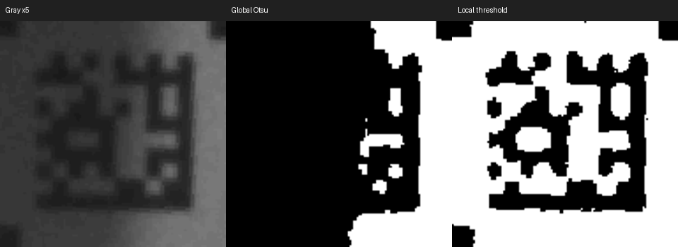

# 补光半遮挡诊断

已修复阴影导致的两处阈值错误，并刷入正式固件。半遮挡现场已恢复连续解码，但仍有极暗帧漏检，尚未达到稳定 50 次成功定位/秒。

## 原图与原因

最初两张完整失败帧为 `half_light01/02.gray8`，每张 1280×720、921600 字节，CRC32 分别为 `BE17BC6F`、`CADA0CCC`。抓图元数据见同名 JSON，PGM 可直接查看；`*_visible.png` 只用于提亮观察，算法回放使用原始 Gray8。

1. `half_light01` 能找到三标记，但整个归一化码区共用 Otsu 阈值，阴影中的白格被当黑格，128/192 两次尝试都失败。
2. `half_light02` 的候选标记存在，但标记间白色间隙共用整条间隙的阈值；亮端设置的阈值把阴影端白纸判成黑色，导致 ROI 被拒绝。
3. 用户恢复半遮挡后继续抓到 `half_restored_fail01/03`。它们能找到 ROI，但阴影对比度变化使局部窗口/阈值仍损失部分模块，说明只修最初两张图不足以代表连续场景。

## 代码

修改 `port/components/xcr_decoder/src/xcr_dmtx.c` 及统计结构 `xcr_dmtx.h`：

- 白色间隙逐点用邻近 ±2 个样本的亮度计算阈值。候选若也通过原整条间隙检查，优先评分，避免阴影补救候选抢走正常候选。
- 解码先走原 128×128 Otsu 快速路径；失败后对同一帧归一化 128×128 图做局部均值二值化；最后保留原 192×192 带边距重试。
- 局部窗口半径为边长的 5/32，阈值为局部均值的 92%。积分图保证局部均值计算为线性复杂度，只处理小图。申请失败释放本次缓冲并继续原大图重试。
- 保留 ECC200 校验、原图角点精修、100 ms 帧龄限制。没有使用上一帧坐标，没有添加整帧逐点 3×3 滤波或更改传感器寄存器。

## 同帧回归

`wsl -e bash tools/build_dm_stage_trace.sh` 构建主机回放工具，`wsl -e python3 tools/check_half_light.py` 复测阴影案例。

- 最初两张图：修改前 0/72，修改后 72/72 个网格相位平移案例成功。
- 加入恢复现场后的成功图、两张额外失败图，共五张原图：6×6 平移、每例连续运行四次，**180/180** 解出 `012345` 且完成精修，见 `half_light_final_regression.json`。
- 全补光两图 72/72、暗光两图 72/72、更早五图 180/180，原大码成功没有丢失，空白/遮挡未误解码。见 `light_on_regression.json`、`speed_sampling_regression.json`、`same_frame_regression.json`。同进程大小码切换 8 例通过，见 `speed_scale_transitions.json`。

平移不是独立拍摄，主机耗时不是板端耗时。180/180 不包含下文仍失败的极暗原图。

## 半遮挡现场实测

用户回复“已恢复”后进行实机验证。最初的现场记录包含恢复遮挡前后的过渡，不能用于相同照明的前后成功率对照。中间局部参数版本也单独保存，最终版本以 `half_light_final92_benchmark.json` 为准。

最终按开图→关图→开图→关图，每段预热 2 秒、采样 8 秒；图片约 0.35 秒请求一次，未开 UVC 实时流：

| 段 | 图片 | 成功定位条数 | 成功定位/秒 | 解码中位数 | 帧龄中位数 | 成功图片/收到图片 |
| --- | --- | ---: | ---: | ---: | ---: | ---: |
| 1 | 开 | 314 | 39.25 | 33.81 ms | 36.53 ms | 19/22 |
| 2 | 关 | 363 | 45.38 | 32.79 ms | 33.65 ms | — |
| 3 | 开 | 274 | 34.25 | 27.00 ms | 27.78 ms | 23/23 |
| 4 | 关 | 368 | 46.00 | 26.26 ms | 26.88 ms | — |

32 秒采样共 1319 条成功定位、45 张图片（其中 42 张解码成功），图片校验错误 0。定位无重复序号，但有序号缺口；缺口同时包含失败、处理跳帧和上传影响，不能全部算成解码失败。`@TIMING` 可覆盖，条数不能当完整成功率分母。现场阴影/成像在不同阶段仍有变化，不能将两段速度差完全归因于某一项计算。

`half_profile_on.json` 为最终固件的抽样分段计时：密集标记搜索通常约 18～25 ms，触发局部二值化时两遍归一化总计约 10～11 ms，后续 ECC 解码约 2.6～3.3 ms、精修约 1.3～1.5 ms；偶有排队等待。`half_profile_off.json` 是前一组局部参数版本，保留作诊断，不能当最终固件关图对照。补救路径增加后段负载，Core 1 还承担图片工作，解释了开图吞吐量下降。

## 仍未解决的边界

`half_restored_fail02.gray8`（CRC32 `A8060A9D`）仍无法找齐三个外部标记，主机同帧也失败，候选见 `trace_half_fail02/04_marker_candidates.csv`。码及标记区域 `[436,170,540,278]` 灰度中位数 11，90 分位数 13，范围 4～25；其中两个标记在当前稀疏搜索中缺失。这是极暗、低对比度条件下仍存在的搜索问题，不能称为全部修复，也不能仅凭低灰度认定无法恢复。临时提高暗区阈值并未解决，还影响其他阴影样本，未纳入正式代码。

下一步需针对该帧评估标记局部去噪/更稳健的候选提取，并结合实际光源、曝光与增益确认信噪比；不通过上一帧 ROI 掩盖丢标记问题。当前不承诺半遮挡条件下 100% 成功率或 50 次定位/秒。

## 固件

ESP-IDF 5.4.0，正式应用 `build/p4scan_ov9281.bin`，838544 字节；COM57 写入哈希校验通过，COM60 用于测试。SHA256 见 `half_firmware.json`，旧固件备份 `build/before_half_light.bin`。最终输入是真实 CSI，没有嵌入图片回放。

现有调试器 EXE 联机约 10 秒，收到 380 条定位及 27 张同帧图片（26 成功、1 失败），图像、角点表格和双核占用显示正常；见 `half_ui_smoke/smoke.json` 与 [截图](half_ui_smoke/window.png)。测试结束已重新启动调试器并自动连接 COM60。
