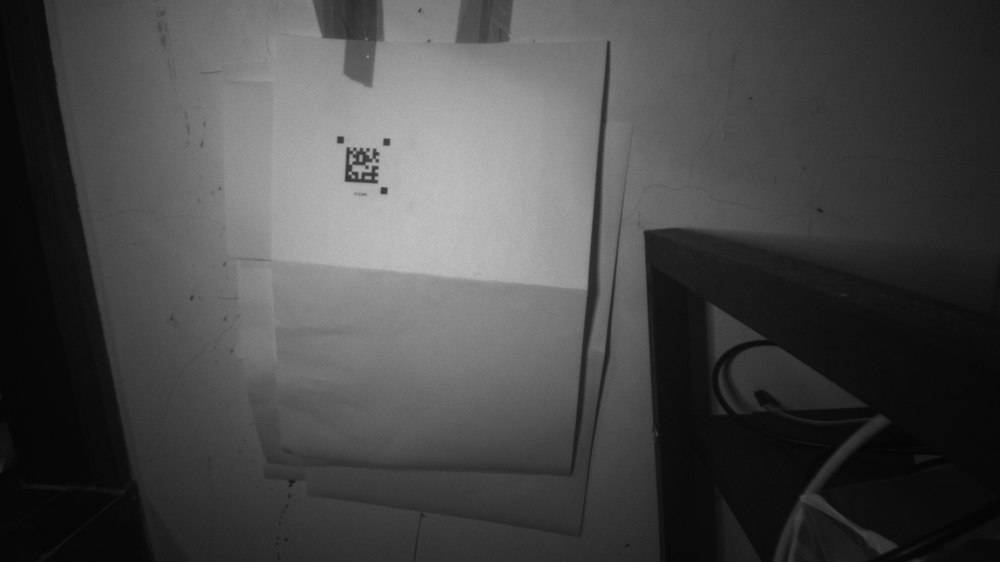

# 补光开启后解码失败

补光开启后的失败已在同一原图上复现并修复，正式固件已使用 ESP-IDF 5.4.0 编译、经 COM57 烧录，写入哈希校验通过。OV9281 寄存器、1280×720 Gray8 和标称 50 fps 保持当前配置。

## 原因

抓取两张板端失败 RAW，见 `light_on01/02.gray8`、同名 PGM 与 JSON。每张 921600 字节，CRC32 均通过。第一张原图灰度范围 4～198，没有饱和到 255 的区域，码与三个标记仍然清晰。

原搜索要求像素同时低于全图阈值和局部均值的 75%。全图阈值取 `min + 35% × (max-min)`，在该图约为 71。补光后纸面示例区域中位数约 170，三个黑色标记示例内部中位数约 62、67、63；经边缘模糊和 3×3 均值验证后，部分标记采样点超过 71。全图暗背景因此限制了亮纸上的黑色判定，标记被裁成一行/一列或不足面积。

主机同帧走 `prepare + prepared decode`，原代码两张图都找不到 ROI，候选列表为空；不是内容码字解码、角点精修或 CSI 数据缺失。实际补光开启的基线测试四段均为 0 条定位/秒，见 [light_on_baseline.json](light_on_baseline.json)。

另外，对 8～12 像素的小标记，补光后的灰边可能多产生一两个采样点，撑大包围框；5 个有效点落在 3×3 包围框中时，原先至少 70% 的实心度门槛会拒绝它。

## 修改

1. 整图二值化采用局部均值判定，取消全图阈值对所有区域的硬性上限。
2. 候选标记在周围白色区域取样，用周围亮度的 65% 提升该候选的滤波验证阈值，同时保留原阈值作为暗光下的下限。
3. 每个候选保存黑心与周围白色之间的局部阈值，三标记的间隙与 DataMatrix 实线边检查使用这些局部阈值，避免全图暗背景继续压低后续验证阈值。
4. 仅对包围框不超过 3×3 采样点的标记，把实心度下限由 70% 调至 55%，补偿面积量化；其他尺寸保持 70%。标记对比度、尺寸比例、直角几何、间隙、实线边、ECC200 和原图精修检查继续执行。

前一轮直接采样、采样间隔选择和 JPEG 优先级优化继续使用。没有恢复暗光下的整图逐点 3×3 滤波，没有添加上一帧位置/ROI 跟踪。

## 验证

- 两张补光失败图各做 6×6 网格相位平移，并连续处理四次，覆盖采样间隔选择：修复前 0/72，修复后 **72/72** 个案例均解出 `012345` 并完成精修。见 [light_on_regression.json](light_on_regression.json)。
- 前轮两张暗光原图的 72 个平移案例仍全部通过，见 [light_fix_dark_regression.json](light_fix_dark_regression.json)。
- 更早五张原图的 180 个平移案例仍全部通过，大码/空白/遮挡用例没有丢失原本成功的解码，空白与遮挡未误解码；见 [light_fix_small_regression.json](light_fix_small_regression.json)。
- 同一进程中的小码、大码、空白与小码切换检查通过。主机耗时不代表板端耗时。

合成亮度探索另外测试了五张原图的六组增益/加性偏移，共 30 组。其中 24 组完成精修，6 组加性偏移导致的低相对对比度样本仍未解码，未出现错误内容；见 [illumination_affine_regression.json](illumination_affine_regression.json)。它们是合成数据，不是六次现场补光失败；本轮修复不保证任意偏置、强反光或低对比度图像都可识别。

## 补光保持开启的实机测试

按开图→关图→开图→关图测试，每段预热 2 秒、采样 8 秒。图片按约 0.35 秒一次请求，不开启 UVC 实时流。

| 段 | 图片上传 | 定位条数 | 成功定位/秒 | 解码中位数 | 帧龄中位数 |
| --- | --- | ---: | ---: | ---: | ---: |
| 1 | 开 | 402 | 50.25 | 23.99 ms | 24.71 ms |
| 2 | 关 | 402 | 50.25 | 23.88 ms | 24.50 ms |
| 3 | 开 | 402 | 50.25 | 24.01 ms | 25.45 ms |
| 4 | 关 | 403 | 50.38 | 23.86 ms | 24.49 ms |

共 1609 条成功定位、43 张成功图片，定位序号重复和缺口均为 0，图片 CRC/尺寸错误 0。定位最大帧龄 44.91 ms。开图 Core 0 约 93.7～93.8%、Core 1 约 46.4～47.0%；关图约 90.3% / 38.6%。记录见 [light_on_final_benchmark.json](light_on_final_benchmark.json)。这是当前固定补光场景的实测，未代表 AGV 运动、其他距离或照明条件。

最后再次抓取当前 CSI RAW，元数据 [light_fixed_current.json](light_fixed_current.json) 为成功帧，CRC32 `8B52CE3D`，处理时间 24.947 ms。

最终产物 `build/p4scan_ov9281.bin`，固件 SHA256 见 [light_firmware.json](light_firmware.json)，修改前固件备份为 `build/before_light_fix.bin`。调试器 EXE 沿用当前版本。

现有 EXE 联机约 10 秒，收到 487 条定位和 20 张成功图片，图像、角点与双核利用率显示正常；见 [界面截图](light_ui_smoke/window.png)、[记录](light_ui_smoke/smoke.json)。已重新打开调试器并自动连接 COM60。
