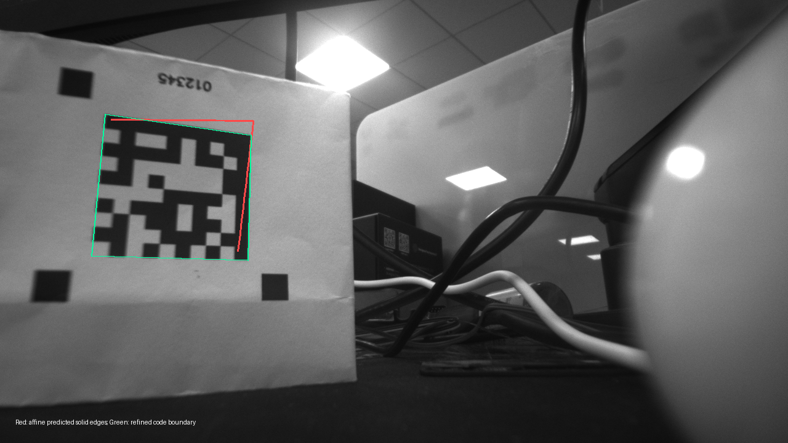
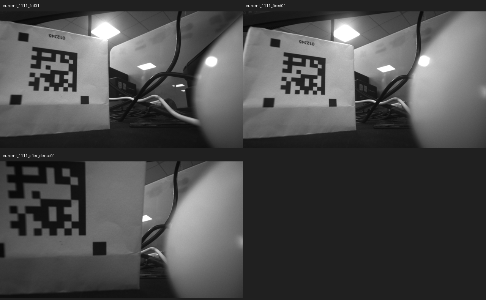

# 2026-11-11 当前环境无法解码

当前环境有三处算法限制：透视码被实线边检查误拒；仿射归一化不能正确采样较强的透视形变；角点精修的搜索范围不足。另外，后续移动过近时曾把码体和外部标记裁出图像边界。算法修复已通过同帧回归并烧录，裁边场景需要完整成像。

## 原图证据

完整失败帧 `current_1111_fail01/02.gray8` 都为 1280×720 Gray8、921600 字节，CDC RAW CRC32 分别为 `909C7087`、`2A644F19`，校验通过。它们不是前一轮极暗半遮挡场景；码体较大，倒置且有透视。

修改前的四段现场测试（开图/关图交替，每段采样 3 秒）均为 0 条定位/秒，记录为 `current_1111_baseline_benchmark.json`。

主机回放发现三个正确外部标记全部存在。6 像素采样时三标记组合 `0,6,7` 通过几何和白色间隙检查，但实线边检查失败；4 像素采样同样失败，因此没有进入归一化与 ECC200 解码。板端分段计时也显示归一化次数为 0，见 `current_1111_profile.json`。

三标记中心只给出仿射估计；透视下码体边缘不再与预估坐标轴平行。原检查只能平移一条采样线，采样线一端落在码外白纸上，达不到 16 点中至少 14 点黑色的条件。诊断程序仅绕过该检查时，两张原图均可解出 `012345` 并完成原图精修，说明数据本身能够恢复。



红线为原仿射预估实线边，绿框为解码后原图精修边界。

## 修复

`xcr_dmtx.c`：

1. 保留原实线边快速检查；失败后搜索两端可分别偏移的直线（各 ±0.15 个归一化标记间距），容纳透视造成的倾斜。补救只检查边的内部区间，避开端点估计误差；仍要求每条边至少 14/16 个黑色支持点，继续执行间隙检查、ECC200 和四边精修。
2. 原图精修先执行原来的 5%/8% 搜索；失败后才增加 14% 搜索，半径上限 40 像素、角点修正上限 48 像素。原先上限分别为 24、32 像素。仍失败时，仅拟合两条实线边，补足缺少外部标记的第四角，再重做完整四边精修。这个中间角不算精定位成功；最终仍须通过完整四边验证。宽范围实线边拟合的半径上限为 64 像素、角点修正上限 80 像素，局部数组为 134/129 项以覆盖最大索引。边拟合支持数、残差、凸性和帧龄验证继续执行。
3. 若粗网格所有解码尝试失败、同帧密集网格成功，则接下来 32 帧由前段直接执行密集整图搜索，然后再尝试普通网格。只记采样选择，不保留上帧位置或 ROI。这样减少后段反复三次归一化后再搜索整图的负担。
4. 增加透视归一化：由本帧三标记估算三个相邻码角，由两条实线边的交点补足第四角，用单应映射生成 128×128 小图，先 Otsu、必要时局部二值化，再走原 ECC200 解码与原图精修。人工白边不参与 Otsu 直方图统计。对间距至少 168 像素、轴夹角余弦绝对值超过 0.06 的当前帧优先走透视路径，其他情况保持原路径并在失败后补救。此路径依赖当前三外部标记对应的 10×10 标签设计，不是对任意大角度或任意标签格式的保证。

`agv_pipeline.c`：每帧完成后 `vTaskDelay(1)`，当前 1000 Hz tick 下为一次约 1 ms 的调度间隙。连续繁重帧会使下帧通知提前到达，原循环可能一直占用高优先级解码任务，使低优先级 CDC/JPEG 任务难以运行。该调度间隙用于保障图片与结果任务运行，不能据此承诺每帧耗时低于 20 ms。

## 回归

最初两张失败图及用户恢复完整画面后的 `current_1111_restored01` 各做 6×6 整图平移，每个案例连续执行四次，覆盖采样状态：修改前 **0/108** 完成精修，修改后 **108/108** 解出 `012345` 并完成精修。角点扣除平移后与原图结果偏差不超过 2 像素。见 `current_1111_regression.json`。

复测命令：

```powershell
wsl -e bash tools/build_dm_stage_trace.sh
wsl -e python3 tools/check_perspective_markers.py
```

可用 `--baseline build/dm_stage_trace_before_perspective1111` 加入本机保存的修改前可执行程序。主机耗时不代表 ESP32-P4 耗时，平移案例不代表 108 次独立拍摄。

旧样本回归：半遮挡五图 180/180；更早小码五图 180/180；全补光两图 72/72；暗光两图 72/72；原有大码成功未丢失，空白和遮挡样本未误解码；大小码/空白切换八例通过。本轮记录使用 `current_1111_` 前缀保存，未覆盖历史实测文件。

## 场景变化与中间测试



后续 RAW `current_1111_fixed01` 已成功解码，但码的位置已变化，不能将全部板端阶段视为同位置、同照明对照。中间版本的结果和分段计时分别保存在 `current_1111_before_scheduler_benchmark.json`、`current_1111_before_dense_benchmark.json`、`current_1111_scheduler_profile.json`。它们暴露了后段负载和低优先级任务调度问题。

`current_1111_after_dense01.gray8`（CRC32 `CAE3A5BC`）中，顶部码体及外部标记已被图像边界裁掉，完整三标记组合不存在；主机也无法解码。该阶段四段零定位记录为 `current_1111_clipped_benchmark.json`，不能当作完整画面下的修复结果。

用户回复“已放好”后抓取 `current_1111_restored01`（CRC32 `B4132714`），码与三个标记完整，但倾斜更强。只有边检查修复时仍失败，记录为 `current_1111_before_projective_benchmark.json`；进一步透视校正后该原图恢复解码和精修。初版透视补救在多次仿射尝试后执行，速度约 11～14 次/秒，见 `current_1111_projective_retry_benchmark.json`；最终根据当前帧几何优先选择透视校正。

## 最终现场测试与剩余问题

最终固件使用真实 CSI 输入，按开图→关图→开图→关图测试，每段预热 2 秒、采样 8 秒。详见 `current_1111_final_benchmark.json`：

| 段 | 图片 | 成功定位条数 | 成功定位/秒 | 成功帧处理时间中位数 | 帧龄中位数 | 成功图片/收到图片 |
| --- | --- | ---: | ---: | ---: | ---: | ---: |
| 1 | 开 | 137 | 17.12 | 48.47 ms | 49.63 ms | 5/8 |
| 2 | 关 | 143 | 17.88 | 47.43 ms | 48.12 ms | — |
| 3 | 开 | 127 | 15.88 | 48.24 ms | 49.73 ms | 4/6 |
| 4 | 关 | 161 | 20.12 | 47.73 ms | 48.33 ms | — |

32 秒采样合计 568 条成功定位、14 张图片，图片校验错误 0。采集名义 50 fps 不等于解码成功频率。定位序号存在缺口，包含处理跳帧、解码/精修失败和上传影响；`@TIMING` 为可覆盖队列，不能按条数计算完整成功率。前后现场姿态曾变化，不能把所有性能变化只归因于代码某一项。

本次“完全不能解码”已恢复为持续输出，但仍有漏检，尚未达到稳定 50 次/秒。Core 0 约 71%，Core 1 约 98～100%。最终抽样 `current_1111_final_profile.json` 中，成功的透视路径归一化及前置几何拟合约 19 ms、核心解码约 2.6～2.7 ms、最终精修约 2.6～2.7 ms；部分帧仍连续执行五次归一化/透视尝试，归一化累计约 45～47 ms、核心尝试累计约 14～17 ms，后段接近满载。仍需进一步改善透视采样稳定性和失败后的计算预算，不能以 108/108 保存图回归代替连续现场成功率。

最终调试器约 10 秒验收收到 145 条定位和 7 张同帧图片（4 成功、3 失败），确认成功结果、失败图片和双核利用率能显示，见 `current_1111_ui_smoke/smoke.json` 与 [截图](current_1111_ui_smoke/window.png)。截图恰为失败帧，因此角点表格为空，不能误称该帧精修成功。验收后已重新打开调试器并自动连接 COM60。

最终另一次 RAW 请求因后段繁忙只收到 225024 字节后超时，未保存为完整原图，未用于回归。此前用于根因分析的四张 RAW 都经完整长度与 CRC 校验；没有用不完整数据代替成功帧证据。

## 固件

ESP-IDF 5.4.0，COM57 烧录且写入哈希校验通过；摄像头保持 1280×720 Gray8、双 MIPI 通道、标称 50 fps，最终使用真实 CSI 输入。固件信息见 `current_1111_firmware.json`，修改前备份为 `build/before_perspective1111.bin`。本轮未更改传感器寄存器或开启 UVC 实时流。
