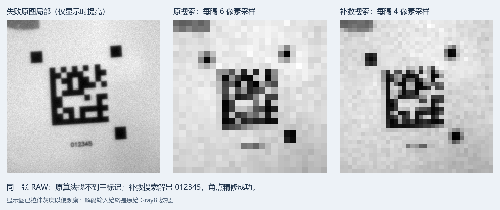

# 当前环境小标记漏检分析与修复

后续用户调整距离/画面后出现的速度下降，原因与修复见 [SPEED_ANALYSIS.md](SPEED_ANALYSIS.md)。该后续版本已增加采样间隔选择，避免小码持续重复搜索；下文保留本轮最初漏检修复的证据和测试条件。

2026-11-10，ESP32-P4 / OV9281，1280×720 Gray8，双通道 CSI，标称 50 fps，ESP-IDF 5.4.0。

## 原因与原始证据

本次能稳定复现的故障在**整帧外部三标记搜索**，没有进入归一化、ECC200 内容解码或角点精修。码体约 60 像素，外部标记约 12 像素；每隔 6 像素取一个采样点时，标记只覆盖约 2 个采样间隔。边缘模糊、阈值和网格相位使某些标记缩成一行/一列，随后被最小尺寸、实心度或形状筛选拒绝。

- 从设备独占 CDC 抓取 `fail01`、`sample02`、`fail03`、`fail04` 四张完整 RAW，均为板端未解码帧。每张 921600 字节，主机 CRC32 与设备一致，元数据见同名 JSON。
- 主机使用与流水线相同的 `prepare + prepared decode` 路径，在相同像素上复现四张失败。`fail01` 板端处理 12.48 ms，原搜索没有 ROI；不是后段解码超时造成的这次失败。
- 原网格间隔 6：四张均失败；间隔 5：三张成功；间隔 4：四张均解出 `012345`、10×10 ECC200，几何精修等级为 2。见 [step_comparison.json](step_comparison.json)。
- `trace01/04_marker_candidates.csv` 中真码只有右下标记保留下来，其余候选是背景。补救搜索的 `trace_fixed/04_selected_markers.csv` 恢复三个标记。

另发现一个量化边界：小标记包围框少一格时，原有三标记最大间距上限会把正确组合拒绝。平移复现中，候选的距离平方为 1685，原上限为 1681；增加合理的网格量化余量后恢复。

图中的灰度仅为方便观察而拉伸。所有算法比较均使用原始 Gray8。失败图中纸面示例区域中位灰度约 112、标记内部约 28，有可用对比度；同帧改变搜索即可解码。因此，本次已证实的主要原因是小标记欠采样，不能仅归结为环境暗或摄像头寄存器不匹配。

## 最终修改

1. 保留原有 6 像素快速搜索；没有找到三标记时，Core 0 在同一帧增加 4 像素搜索。
2. 快速网格找到候选但后段内容解码失败时，在当前帧有效期内再做一次 4 像素整图搜索，避免错误候选挡住真实码。
3. 每帧保存实际采样间隔，间隙/实线验证、归一化的半步偏移、角点精修种子使用相同间隔，防止“用 4 像素搜索、按 6 像素映射”的坐标偏差。
4. 三标记最大间距容差从双倍坐标的 `+2` 调为 `+4`，保留尺寸比例、直角、白色间隙、DataMatrix 实线边及 ECC200 校验。
5. 仅在密集搜索中使用滑动局部求和及 16 位洪泛队列。4 像素网格的工作区由 288000 字节降到 175680 字节；大于 65535 个采样点自动使用 32 位队列。

6 像素快速路径保留原积分图和工作区安排。将滑动求和也用于快速路径的试验，在本机开图时只有约 45 次定位/秒；恢复原快速路径后回到约 50 次/秒。进一步缩成环形洪泛队列的试验没有提速，未纳入最终代码。

仍是 Core 0 搜索、Core 1 后段解码/精修和图片发送的跨帧流水线。补救使用当前整帧像素，没有引入上一帧位置或 ROI 跟踪。

## 同帧回归

以四张失败图及另一张现场成功图 `current06` 为基础，将整帧分别横向、纵向平移 0～5 像素，覆盖原网格的 36 种相位。它们是合成平移案例，不能当作 180 次独立现场采集。

| 原图 | 修复前成功精修 | 修复后成功精修 |
| --- | ---: | ---: |
| fail01 | 4/36 | 36/36 |
| sample02 | 7/36 | 36/36 |
| fail03 | 4/36 | 36/36 |
| fail04 | 7/36 | 36/36 |
| current06 | 14/36 | 36/36 |
| 合计 | 36/180 | 180/180 |

已成功的内容均为 `012345`，未出现其他内容。原有 14 个大码平移、跨中线、空白与遮挡样本，解码内容、ROI、角点和几何等级与修复前一致；另添加三个大面积随机连通场景。不同采样间隔 2/3/4/6 的 88 组结果与原积分图实现一致，覆盖 16 位和 32 位队列。记录为 [same_frame_regression.json](same_frame_regression.json)、[rolling_sum_regression.json](rolling_sum_regression.json)。

主机耗时受平台、缓存及逐阶段文件写入影响，不代表板端耗时。工具为 `tools/check_small_markers.py` 和 `tools/dm_stage_trace.c`；前者需要修复前的 `dm_stage_trace_baseline` 与当前 `dm_stage_trace` 两个主机程序。诊断时的旧源快照保存在被 Git 忽略的 `build/xcr_dmtx_before_small_marker.c`。

## 板上回放与现场实测

先把 `fail01.gray8` 暂时嵌入试验固件，复制到 PSRAM，让两级流水线重复处理同一失败图，CSI 继续取帧，图片上传仍按约 0.35 秒一次请求。回读 RAW 的 CRC 为 `8D2E631F`，与原失败图一致，修复后能完成精修并输出定位。这是保存图回放，不是现场成功率测试。

直接增加密集搜索的试验约 23～26 次定位/秒；滑动求和试验约 28～30 次/秒，解码中位数由约 45 ms 降至约 41 ms。记录见 [replay_before_workspace_optimization.json](replay_before_workspace_optimization.json) 和 [replay_optimized_benchmark.json](replay_optimized_benchmark.json)。这些回放试验用于验证补救路径及评估代价，不能用最终普通画面的 50 次/秒承诺小标记补救吞吐量。

正式固件已移除嵌入图片和回放代码，恢复真实 CSI 输入。最终现场按开图→关图→开图→关图，每段预热 2 秒、采样 8 秒，结果见 [live_final_benchmark.json](live_final_benchmark.json)：

| 段 | 图片 | 成功定位/秒 | Core 0 | Core 1 | 解码中位数 | 帧龄中位数 |
| --- | --- | ---: | ---: | ---: | ---: | ---: |
| 1 | 开 | 50.25 | 92.2% | 61.2% | 26.50 ms | 29.15 ms |
| 2 | 关 | 50.12 | 86.8% | 52.9% | 25.93 ms | 26.57 ms |
| 3 | 开 | 50.25 | 92.1% | 61.7% | 26.51 ms | 28.51 ms |
| 4 | 关 | 50.25 | 86.8% | 52.6% | 25.94 ms | 26.58 ms |

合计 1607 条成功定位、44 张成功图片，图片校验错误 0，定位序号重复和缺口均为 0；最大定位帧龄 68.07 ms。图片发送时 `@TIMING` 仍允许覆盖，因此不能用其条数作总处理帧数或成功率分母。应用取帧序号连续也不等于 CSI 硬件绝无丢帧。

距离、码尺寸或姿态变化到持续触发密集补救时，处理速度仍会下降；本轮并未证明全视场、所有距离或 AGV 运动条件均可每秒成功 50 次。更远距离时，增加码在图像中的像素尺寸、改善聚焦和照明，仍能减少采样损失与补救开销。

## 构建与恢复

- 正式固件：`./build_p4.ps1`，ESP-IDF 5.4.0，`build/p4scan_ov9281.bin`，应用大小 820720 字节。
- 已经通过 COM57 刷入，写入哈希校验通过；COM60 用于结果与图片测试。
- 正式源文件及 ELF 均无回放图片或回放符号。刷机前的板上应用备份为 `build/baseline_before_small_marker_fix.bin`。
- 调试器支持的图片上传、双核利用率和定位数据显示保持现有协议；本次不需要重做 EXE。
- 最后使用现有 EXE 联机约 10 秒，收到 487 条成功定位、20 张成功图片，双核利用率及角点表格正常显示；见 [界面截图](ui_smoke/window.png) 和 [记录](ui_smoke/smoke.json)。已重新打开调试器并自动连接 COM60。
- 正式固件 SHA256 与回放 CRC 核对信息见 [firmware.json](firmware.json)。
