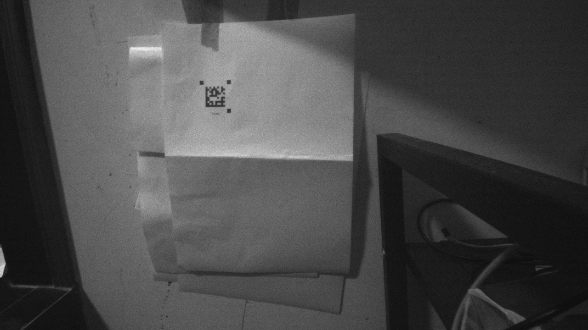

# 暗光小码场景速度下降：原因、修改与实测

后续补光开启后的阈值修复与该场景实测见 [LIGHT_ANALYSIS.md](LIGHT_ANALYSIS.md)。本文数据保留为补光关闭时的历史对照。

本轮用户报告“当前环境，解码速度太慢”。沿用 ESP-IDF 5.4.0、1280×720 Gray8、标称 50 fps、两级跨帧流水线、按需解码图片上传。未更改 OV9281 寄存器、分辨率或帧率。已编译并通过 COM57 刷入最终固件，哈希校验通过。

## 已证实的原因

当前码体边长约 44 像素，外部标记约 8～12 像素。上一轮约 60 像素码体在某个采样位置达到 50 次/秒，不能直接作为此场景的结果。本轮取到的两张原始图见 `slow_current01.gray8`、`slow_current02.gray8` 和同名元数据；均为 921600 字节，CRC 通过。

1. **整图滤波在暗光下退化成几乎全图操作。** 原标记搜索对采样值 `<48` 的像素执行 3×3 均值。当前第一张 RAW 中 921599/921600 个像素低于 48，导致 6 像素和 4 像素两遍搜索都对几乎所有采样点读取九个原图像素。两张图的同帧主机结果均使用 4 像素搜索完成精修；取消初始采样的重复滤波后仍解出相同内容。候选验证、暗点一致性、间隙、实线边、内容校验及后段滤波仍保留。
2. **小码每帧重复整图搜索。** 先做 6 像素快速搜索，漏检后做 4 像素补救，在此固定场景持续付出两遍代价。Core 0 已达到约 99.2%，Core 1 仅约 26%；前段成为吞吐量瓶颈。
3. **100 ms 帧龄门槛扩大了开图时的损失。** 原场景中单帧处理约 52.7 ms、定位帧龄约 87～89 ms。图片处理期间的调度/内存竞争进一步增加等待，导致部分结果不能在期限内发送。保留门槛，避免 AGV 使用过期定位。

实测基线 [current_speed_baseline.json](current_speed_baseline.json)：开图约 15.3～15.5 条有效定位/秒，关图 23 条/秒。内容解码成功的 `@TIMING` 消息比实际定位行多，不能把两者混为“成功速度”。

上图仅为观察而拉伸灰度；实际算法输入始终是未拉伸 RAW。

## 最终修改

- 初始整图采样直接读取 Gray8；仅对少量候选及后段需要的像素进行滤波。
- 每次搜索仍遍历整帧。若 6 像素网格漏检而 4 像素网格找到小标记，下一次直接使用 4 像素整图搜索；标记间距达到约 126 像素、对应标记宽约 18 像素时回到 6 像素网格。使用原子变量只记录 `4/6` 这个采样间隔，不记录坐标、ROI 或上一帧图片。场景中的码移动时仍做整图搜索。
- 每帧保留自己的实际采样间隔，后段始终使用同帧的搜索结果和坐标偏移。
- JPEG 任务优先级由 9 降到 7，低于 Core 1 解码任务的 8。CDC 仍为 7，TinyUSB 端点任务保持原配置。图片仅按请求生成并上传。
- 增加默认关闭的 `@PROFILEON/@PROFILEOFF` 阶段计时，每秒最多一条 CDC 诊断，不开启同步 FS 详细打印；见根目录 `USB_PROTOCOL.md`。

该策略会在新场景的第一帧或尺寸切换时产生额外搜索。无标记或严重遮挡时仍可能需要补救路径；没有承诺任何场景都达到 50 次成功定位/秒。

## 同环境逐项对照

每组按开图→关图→开图→关图采样，预热 2 秒。基线和直接采样试验每段 6 秒；间隔选择试验每段 10 秒；最终 JPEG 优先级 7 的试验每段 8 秒。结果是短窗口实测范围，未声称统计置信区间。

| 版本 | 开图定位/秒 | 关图定位/秒 | 单帧解码中位数 |
| --- | ---: | ---: | ---: |
| 本轮原固件 | 15.33～15.50 | 23.00 | 52.6～52.7 ms |
| 取消初始整图滤波 | 35.00～35.33 | 37.00 | 34.9～35.1 ms |
| 再避免小码重复搜索 | 45.70～46.20 | 50.20～50.30 | 约 26.1 ms |
| 最终：JPEG 优先级 7 | **47.25～47.88** | **50.25** | **约 26.1 ms** |

对应原始记录：

- [直接采样试验](speed_direct_sampling_trial.json)
- [采样间隔选择试验](speed_scale_final_benchmark.json)
- [最终开关图片对照](speed_preview7_benchmark.json)

最终四段共 1565 条定位、43 张成功图片，图片 CRC/尺寸错误 0，定位序号无重复。关图两段定位序号无缺口；开图两段仍有 16、17 个应用序号缺口，不能宣称图片处理完全无代价，也不能仅凭这些缺口断定 CSI 硬件丢帧。开图 Core 0 约 89.8～90.8%、Core 1 约 56.6～56.8%；关图约 88.6% / 51%。最大已发定位帧龄为 56.98 ms，低于 100 ms。

本轮图片请求仍约每 0.35 秒一次，实际约 2.6～2.8 张/秒，不是实时上传 50 张/秒。

## 阶段计时

阶段诊断记录为 [关图](speed_final_profile_off.json)、[开图](speed_final_profile_on.json)。默认关闭；取的是每秒最新一帧，不是所有帧，也不能用其条数算成功率。

典型关图帧：

| 阶段 | 耗时约 |
| --- | ---: |
| Core 0 整图搜索 | 17.0 ms |
| 两核交接等待 | 0.03 ms |
| Core 1 归一化 | 4.8 ms |
| 内容解码 | 2.5 ms |
| 原图角点精修 | 1.4 ms |

两核跨帧重叠后，约 26 ms 的单帧处理可以产生约 50 次/秒结果。不能用单帧处理时间倒数推断流水线吞吐量。瓶颈仍主要在 Core 0；交接等待和 ECC200/精修不是本轮慢的主要原因。开图仍存在快照复制、JPEG 和 CDC 竞争，最终实测约 47～48 次/秒。

## 正确性与最终产物

- 两张当前暗光原图，每张横向/纵向平移 0～5 像素，并连续处理四次以覆盖采样间隔选择：72/72 个案例均解出 `012345` 且完成角点精修。修改前的同图比较为 70/72，见 [speed_scale_current_regression.json](speed_scale_current_regression.json)。
- 前次五张原图的 180 个平移案例仍为 180/180，原有大码、遮挡和空白用例没有丢失原本成功的定位，空白/遮挡未误解码；见 [speed_scale_small_regression.json](speed_scale_small_regression.json)。
- 在同一进程内连续切换小码→大码→空白→小码，八个案例的内容和精修通过；见 [speed_scale_transitions.json](speed_scale_transitions.json)。主机时间仅用于算法检查，不代表板端时间。
- 最终固件信息见 [speed_firmware.json](speed_firmware.json)，构建产物为 `build/p4scan_ov9281.bin`。修改前应用已备份为 `build/before_speed_fix.bin`。没有嵌入回放图片。
- 使用现有 EXE 联机约 10 秒，收到 460 条定位及 20 张成功图片，图像、双核利用率和角点表格均已核对；见 [界面截图](speed_ui_smoke/window.png)、[UI记录](speed_ui_smoke/smoke.json)。最后已重新打开调试器并自动连接 COM60。

此次现场结果证明当前环境已有明显提速，仍需 AGV 在实际移动速度、距离与光照变化下验证。
