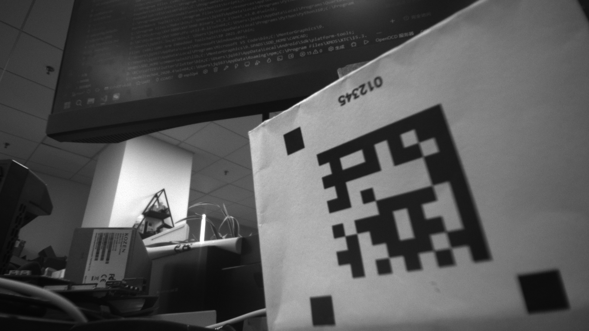

# 2026-11-11 强透视解码与图片卡顿修复

固件已用 ESP-IDF 5.4 编译并经 COM57 烧录校验。当前固定画面实测开图 47.5 次成功定位/秒，关图 50.25～50.38 次/秒；四段各 8 秒，共 1565 条成功定位，连续帧序号无缺口。44 张 JPEG 全部成功，无传输校验错误。本次结果仅对应当前固定光照与姿态，不代表 AGV 运动中的全场景成功率。

## 原因与修改

用户将标签移回画面后，三个外部标记均完整。失败原图 `stutter_restored01.gray8` 和 `stutter_restored_fail01.gray8` 的 CRC32 分别为 BAACF465、7F401EDB。近端标记宽约 112 像素，远端约 48 像素；原两倍尺寸门槛会拒绝组合。放宽大标记尺寸门槛后，仿射估计仍使实线边采样落到白纸上，无法进入解码。

1. 大标记允许最多三倍宽高差，小标记保留原两倍限制。使用本帧三个标记的连通域面积估计单应映射的分母：平面局部面积与分母的三次方成反比，因此 `1+g=cbrt(A_origin/A_horizontal)`，`1+h=cbrt(A_origin/A_vertical)`。该估计仅用于大且尺寸明显不同的标记；映射地平线接近标签的估计被拒绝。状态保存在每帧槽内，不保存上一帧位置。
2. 强透视估计先经过短路径实线边验证；失败仍可使用仿射边检查。保留三标记几何、白色间隙、每条实线边至少 14/16 黑点、ECC200 纠错以及最终原图四边精修。面积只是初值，不直接作为定位输出。
3. 从本帧透视四角直接采样 100 个模块，每模块五点平均，先全局 Otsu，必要时使用模块邻域阈值与小幅采样相位补救。复用原有码字提取、Reed–Solomon 纠错和载荷解释，避免生成 128×128 小图后重复搜索。失败时仍保留原归一化通路。该直接路径针对当前带三标记的 10×10 标签，其他场景沿用已有路径。
4. 图片卡顿源于后段透视重试持续占用 Core 1，低优先级 CDC/JPEG 得不到运行机会；曾出现 RAW 传到部分即超时。现将 CDC 放在 Core 0、优先级 9，JPEG 设为优先级 8 且可在任一核运行；解码保持 Core 1、优先级 8。保留每帧末的一个 tick 调度间隙。

调试器继续按约 0.35 秒一次的 `@SNAP` 请求上传成功/失败的解码同帧图，不启动实时 UVC 视频流。因此当前约 2.75 张/秒是请求节奏，不能按 50 fps 连续视频衡量。协议测试中图片均通过完整接收与校验。

## 最终板端实测

数据：`stutter_final_benchmark.json`。开关图交替四段，每段预热 2 秒、统计 8 秒。

| 项目 | 开图第 1 / 2 轮 | 关图第 1 / 2 轮 |
| --- | --- | --- |
| 成功定位/秒 | 47.50 / 47.50 | 50.25 / 50.38 |
| 成功定位条数 | 380 / 380 | 402 / 403 |
| 图片张数 | 22 / 22 | 0 / 0 |
| 定位耗时中位数 ms | 26.11 / 26.32 | 26.07 / 26.36 |
| Core 0 使用率中位数 | 90.5% / 91.4% | 86.8% / 88.2% |
| Core 1 使用率中位数 | 54.5% / 54.4% | 50.7% / 50.6% |

各段定位序号均无重复、无缺口，上传图片全部标记成功，图片错误为 0。`@TIMING` 可被后续帧覆盖，不能独立作为全帧成功率分母；这里同时检查定位帧序号连续性。开图仍有约 5.6% 吞吐损失，尚未实现带图片稳定 50 次/秒。

开启图片的抽样分段计时见 `stutter_final_profile.json`：前段通常约 16～18 ms，交接等待约 0.03 ms，透视准备约 5.5～5.8 ms，模块解码约 0.5～0.6 ms，四边精修约 2.6～2.9 ms。两级流水重叠运行，端到端约 26 ms 不能直接取倒数作为吞吐；当前主要负载已转至 Core 0 前段搜索，Core 1 不再接近 100%。上传偶尔使前段延长至约 30 ms。

最终重新抓取的 `stutter_final01.gray8` 为完整 921600 字节，CRC32 为 3446F925，板端标记成功，耗时 26973 µs。固件大小与 SHA256 见 `stutter_firmware.json`，构建与烧录日志在 `build/stutter_build.log`、`build/stutter_flash.log`。

## 验证

- 当前两张强透视失败图和此前三张透视图，共 180 个整图平移案例，全部恢复 `012345` 并通过四边精修；扣除平移后角点误差不超过 2 像素。`stutter_perspective_regression.json` 保留同帧前后对比。
- 独立 ZXing 编码的七组不同载荷、镜像、纠错和无效网格共 72 例通过，见 `grid10_regression.json`。这验证直接模块 API 没有写死当前载荷。
- 半遮挡 180/180、小码 180/180、补光 72/72、暗光 72/72，原成功场景无退化，空白/覆盖样本未误解码，大小码和空白切换 8 例通过。本轮文件以 `stutter_` 前缀保存，原历史 JSON 已恢复。
- UI 接收烟测输出在 `stutter_ui_smoke/`；测试后重新打开调试器连接 COM60。

平移回放用于验证采样网格相位，不是独立现场帧；主机耗时不用于板端性能结论。未更改摄像头寄存器、1280×720 RAW8、双通道 CSI 或标称 50 fps 配置。
