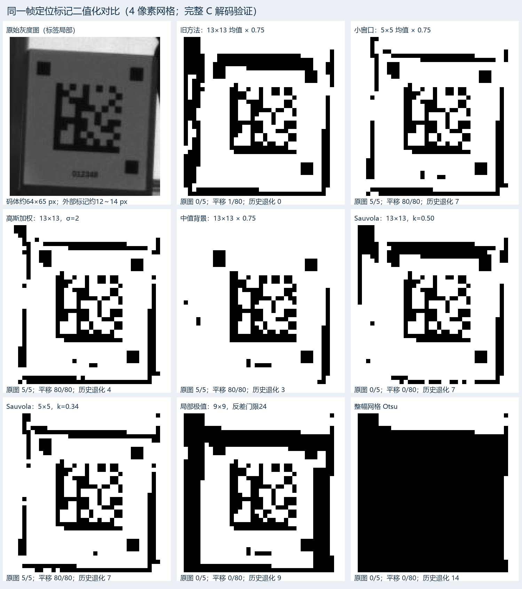

# captures 图片二值化方法对照

## 结论

仅针对这5张图，13×13中值背景阈值比原来的13×13均值阈值更能抑制标签上沿亮背景造成的黑色粘连，二值图中的三个外部方块最清楚。但完整解码结果没有超过已经修复的双窗口方法；直接全局替换还会损失历史场景。

建议继续使用当前快速搜索与4像素双窗口补救。后续优化重点是减少错误候选与重复搜索，而不是将整幅图改为更复杂的二值化。中值背景可作为当前帧疑似粘连区域的实验性补救，需另行实现、回归与板端计时，当前证据尚未证明它带来额外解码收益。

后续已逐阶段分析3张中值退化图，并对无码场景计数验证补救开销，见 [详细诊断与因果对照](median_detail/README.md)。captures原图也已归档到历史样本根目录。

再进一步比较方向背景估计、形态学与异常连通域局部重分割，优先候选现为“异常连通域内Otsu”，见 [后续方法研究](background_exploration/README.md)。方向背景全图替换的C原型尚未体现速度优势。

## 输入和验证方式

- 来源：`C:\Users\jq163\Downloads\captures`，5张1280×720 JPEG，标签内容012348。
- 原图5张；每张向右/向下平移0～3像素，各16种采样相位，共80组，包括原始相位。这80组不是80张独立照片。
- 历史灰度样本27张，其中当前方法23张通过完整解码和精定位；另有空白、遮挡负例2张。
- 共9种方法（包含当前产品方法）×109组输入＝981次完整C算法回放。
- 实验仅在临时C源码中替换标记搜索的二值网格。后续候选筛选、三标记组合、归一化、码体二值化、ECC解码及角点精修沿用真实产品代码。成功标准为内容正确且`geometry_quality=2`。
- 固定方法在6像素和4像素网格上都替换阈值，当前方法按原产品流程在两种步长与窗口间选择。表中方法窗口指**采样网格点数**；4像素网格上的13×13、5×5窗口覆盖约52×52、20×20原图像素范围。

## 实测结果

| 标记二值化方法 | 原图成功 | 采样相位成功 | 相对当前方法损失的历史样本 |
|---|---:|---:|---:|
| 当前产品：常规窗口＋4像素小窗口补救 | 5/5 | 80/80 | 0 |
| 固定13×13均值×0.75 | 0/5 | 1/80 | 0 |
| 固定5×5均值×0.75 | 5/5 | 80/80 | 7 |
| 13×13高斯加权，σ=2，乘0.75 | 5/5 | 80/80 | 4 |
| 13×13中值×0.75 | 5/5 | 80/80 | 3 |
| Sauvola 13×13，k=0.50，R=128 | 0/5 | 0/80 | 7 |
| Sauvola 5×5，k=0.34，R=128 | 5/5 | 80/80 | 7 |
| 局部极值中点9×9，反差门限24 | 0/5 | 0/80 | 9 |
| 整幅网格Otsu | 0/5 | 0/80 | 14 |

所有替换方法均未恢复当前方法失败的4张历史样本。两个负例在所有方法下均未误解码。历史损失指当前方法已成功的23张中的退化数，不能将某方法在本目录5张图上成功理解为已经适合全部场景。

表中结论只针对所列窗口和参数，不代表穷举了Sauvola等算法的最佳参数。这里的整幅网格Otsu和定位后的局部码体Otsu用途不同：前者受整幅场景亮暗分布影响严重；后者在已经隔离的码体内仍可有效使用。

## 为什么失败，为什么中值有效

标签的纸面偏暗，上沿外面背景很亮。局部算术均值容易被亮背景抬高，导致原本应当保持白色的纸面也低于阈值，上方两个实心方块因此连接为长条。后续方块长宽比检查剔除这个连通域，尚未进入码体纠错解码。

缩小均值窗口能减少亮背景影响。中值取邻域排序后的中间灰度，亮像素在邻域中不足一半时不易抬高背景估计，因此这组图片的纸面更干净。但大面积实心标记可能使中值背景也变暗，标记内部出现孔洞，不能把它作为所有尺度的统一方案。

## P4上的实现取舍

1. 标记搜索继续使用廉价的整数滚动均值和多尺度窗口；失败补救仍来自当前帧，不使用上一帧ROI。
2. 若要继续改进，可从当前帧长条连通域或阈值异常区域产生候选，仅在这些区域尝试中值背景或更细采样。它是待实现方案，不能按已验证的性能改进上报。
3. 定位成功后继续在小块归一化码体中使用Otsu，阴影时使用已有局部均值补救。此目录的问题首先在外部标记定位，改变码体二值化并不能消除上游粘连。
4. Sauvola需要均值、方差及平方根或等效近似；大窗口中值需要排序/直方图更新。都比现有单均值滚动求和更复杂，应优先限制在小区域。不能从主机回放时间推算P4耗时。
5. 不建议对整个4像素搜索二值图直接做开运算去粘连：12～14像素标记在此网格中仅约3个点宽，腐蚀可能消灭有效标记。

## 文件与复现

- `report.json`：每次回放、参数方法摘要及产品源码SHA256；时间字段包含主机文件读取，不作为MCU性能数据。
- `comparison.png`：首张图片的原灰度与8种二值化对照。
- `tools/analyze_capture_binarization.py`：离线生成网格，在`build/binarization_comparison_20261118`中构建临时实验程序；不修改产品源码、不烧录固件。

验证局限：这些输入经过JPEG压缩，不是原始CSI RAW8；需要现场原始帧和板端计时才能决定是否合入新方法。本次仅形成分析和离线实验，P4固件及两个UI没有因此改动。
