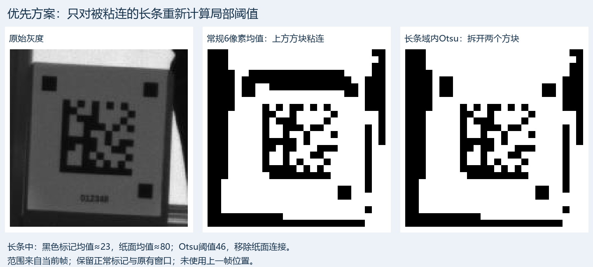
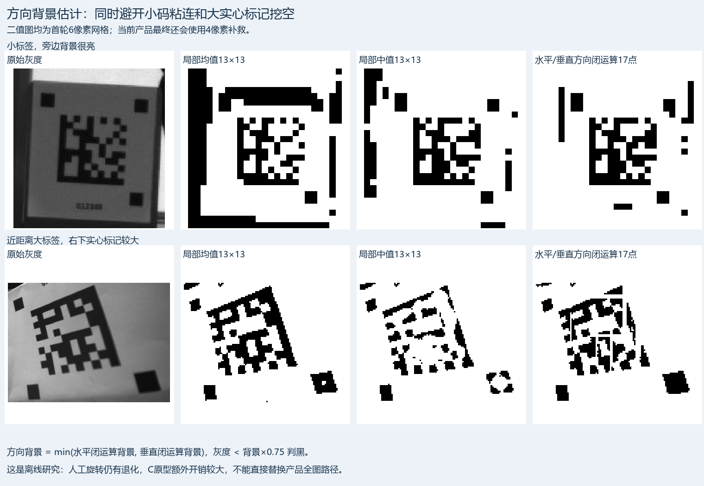

# 后续方法研究：优先修复异常连通域

## 当前建议

优先把“异常连通域内重新分阈值”做成P4实验版本：保留现有均值窗口，对已经发现但因长宽比不合格而将被丢弃的粘连长条，使用这个连通域内的灰度直方图计算Otsu，拆开纸面连接，再提取其中的方块。它比固定中值全图替换更符合当前失败原因，也比每帧全图方向滤波更有希望控制成本。

## 为什么能处理这批图

首图6像素网格中的上方粘连长条有49个黑色采样点：其中真正标记约10点，平均灰度23；被误判黑的纸面约39点，平均灰度80。只使用这49个点的灰度求Otsu，得到阈值46，纸面连接被移除，两个标记恢复分离。

计算范围来自当前帧的连通域，不使用上一帧位置。参与直方图的点也是原二值图中已被判黑的域内点，标签外的大量亮背景不会再次把阈值抬高。

这个策略不对形状正常的实心方块做内部重新阈值，因此可避免固定中值窗口把大标记中央挖白的问题。还要保留原有灰度、对比度、三标记几何、ECC及角点精定位检查，不能只凭重分割后出现三个方块就上报姿态。

## 实验步骤和界限

本轮仍是离线实验：生成临时标记二值掩膜，再交给真实C算法继续做候选筛选、解码和角点精修。掩膜按实际搜索半径分别生成，保留产品的13×13与5×5均值窗口，不把小窗口覆盖成相同的固定大窗口。

实验性触发条件：

- 连通域短边至少2点，长边不超过64点；长短边比超过现有约1.67的方块范围，域内至少8点。
- 每次搜索至多处理8个异常域，参与阈值估计的域内采样点累计最多4096点；矩形遍历和后续筛选另有开销，不能把4096当作整个补救过程的总指令数。
- Otsu分出的深、浅两类各至少4点，两类平均灰度差至少12；否则保持原掩膜。
- 只删除该异常域中高于阈值的纸面连接，不把原本白色的全图区域新增成黑色候选。

若做板端实现，应复用现有洪泛得到的连通域点队列构建256级直方图，局部重新提取方块，避免额外执行一次全图连通域遍历。当前Python实验独立计算连通域，不能直接拿它的计时当作这种C实现的耗时。还需限制局部矩形面积、组合数量、时间预算和候选替换策略。

## 扩展回归结果

输入32张历史灰度样本（含刚归档的5张），每张平移0～5像素，6×6相位共1152组；另加小码/大码的16组旋转和缩放，以及17组已有场景/负例，共1185组。成功标准为内容与当前成功结果一致，且`geometry_quality=2`。

| 方法 | captures的180个平移组 | 相对当前方法损失的成功组 | 恢复当前失败的组 |
|---|---:|---:|---:|
| 当前产品 | 180/180 | 0 | 0 |
| 异常域内Otsu重分割 | 180/180 | **0** | 0 |
| 水平/垂直方向闭运算17点 | 180/180 | 2 | 0 |
| 水平/垂直方向闭运算33点 | 180/180 | 3 | 0 |
| 方形闭运算17×17 | 180/180 | 10 | 0 |

局部重分割没有提高当前样本集最终成功数：当前算法本来已经通过小窗口补救解出这批图。它的价值是把更多帧在粗网格阶段直接处理成功，减少依赖后续细搜索的机会。

在captures的180组中，当前方法仅2组以6像素网格完成，178组最终用4像素；局部重分割173组以6像素完成，7组仍用4像素。每组回放单独启动、使用初始搜索参数。实际板端会保留成功窗口/步长选择，热态搜索次数不同，因此不能将该比例直接换算成实际帧率增幅。

此前中值失败的3张原图在局部重分割中都保持成功。空白、遮挡负例未出现误解码。没有让原本失败的输入新增成功，仍需继续收集真实失败原始帧，不能把人工平移当作独立现场拍摄数据。

首图6像素搜索的所有局部修复共涉及417个域内点，标签上沿长条只占其中49点；5张原图共涉及311～417个点。均匀空白没有触发修复，遮挡负例仍触发887点、7个局部修复。因此“无码”不等于必然零额外开销，应按异常域和预算触发。

## 第二条可用思路：方向闭运算估计背景

分别做水平与垂直灰度闭运算，再取两者较低值作为背景：

`背景 = min(水平闭运算(图像), 垂直闭运算(图像))`

`灰度 × 100 < 背景 × 75` 时判黑。

闭运算是先局部取最大值，再局部取最小值。恰当的窗口能填平深色实心标记，同时保留大片纸面和亮背景的边界。取两个方向较低的背景，可减少某一个方向的亮背景侵入。它不需要平方根或邻域排序。

在小标签纸面，灰度80，方向方法阈值约61，使纸面保白；在近距离大标记中心，灰度14，17点方向方法阈值约53，使中心保持黑色。相较中值，它同时改善了小码粘连和大标记挖空。

但它不适合直接全图替换：17点方案在`stutter_final01`人工旋转−7°、15°的两个输入上退化；33点方案在`current06`的一个相位及大码缩小的两个输入上退化。

## 方向滤波的真实C原型并没有证明更快

已用单调队列写了临时C原型，每次方向极值操作为线性复杂度，并复用后续候选队列内存。196次二值掩膜比对与OpenCV逐点一致。49张输入、3种方法各做32帧主机批次；计时包括方向滤波本身，而不是只测预先计算好的掩膜。

在本次PC上，方向17点原型的平均单帧耗时示例：

| 输入 | 现有均值路径 | 方向17点C原型 |
|---|---:|---:|
| captures首图 | 631 µs | 1220 µs |
| stutter_final01 | 444 µs | 1221 µs |
| 均匀空白 | 666 µs | 1508 µs |
| 遮挡负例 | 805 µs | 2385 µs |

搜索轮次减少，仍可能被4次方向极值遍历、内存访问与分配抵消。原型还保留了某些不再必要的采样积分计算，有继续优化空间，但不能据此承诺板端更快。粗网格额外内存峰值约856字节，4像素网格需要额外58,880字节；P4上缓存、PSRAM和上传竞争都要另测。

因此，方向方法优先作为局部实验备选，正常路径先保留便宜的滚动均值。

## 其他方法的适用性

首轮还对125组输入做了12种方法、1500次C回放，包含多种方形闭运算、分块Otsu、MSER区域和Canny四边形。

该实验中的分块阈值、MSER区域合并掩膜、边缘四边形掩膜都有明显退化，不优先合入当前流程。这不能证明MSER等独立定位器本身无效：实验将它们转为二值掩膜，再沿用现有的32候选与三方块选择逻辑，接口方式也会影响结果。若完全改写为多阈值灰度区域树或独立方块检测器，需要更多代码与实时性验证，当前问题优先做局部修复成本更可控。

## 文件

- `report.json`：12方法×125输入的首轮结果。
- `phase_report.json`：4方法×1185输入的形态学扩展结果。
- `component_report.json`：当前方法与异常域局部Otsu的1185组对照。
- `component_roi_report.json`：原图局部阈值、域内灰度和处理点数。
- `c_prototype_report.json`：方向滤波真实C原型的逐点比对和主机计时。
- 工具：`tools/explore_marker_backgrounds.py`、`tools/check_morphology_phases.py`、`tools/check_component_rethreshold.py`、`tools/benchmark_directional_closing.py`。

以上为研究阶段结果，当时没有修改或烧录P4产品固件，没有修改两个UI。

后续已将异常连通域局部Otsu集成到实际C搜索流程，并完成回放、板端有码/无码及图片上传对照，见[最终集成与实测](../../component_split_20261118/README.md)。最终仅在6像素粗搜索启用补救，4像素保留原有常规/小窗口路径；正常现场速度基本持平，无码平均增加约0.59 ms，不能将研究回放中的粗搜索完成比例当成实际帧率增幅。
