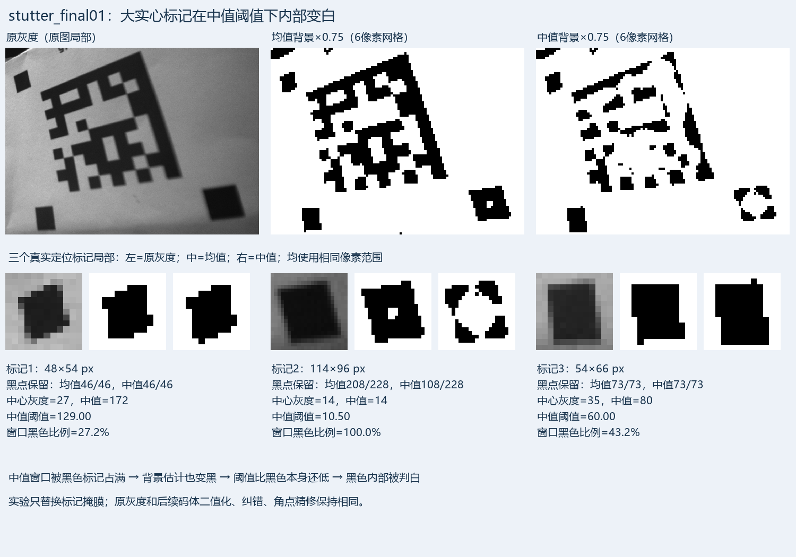

# 中值阈值的3张退化图与无码补救开销

## 已归档的 captures

`C:\Users\jq163\Downloads\captures` 中5张原JPEG和5份原JSON已复制到 `docs/failure_diagnosis/` 根目录，保留原名，内容与源文件逐一校验一致。另外各生成同名PNG和1280×720 `.gray8`，使现有历史回归工具也能找到它们。

这些新Gray8来自JPEG解压，**不是传感器原始CSI RAW8**。完整来源、文件清单与JPEG SHA256见 [归档清单](../../captures_20261118/import_manifest.json)。原抓图JSON中的失败结果没有改写；修复后的回放结果单独记录。

## 无码图会不会变慢

**会。** 小窗口是常规搜索失败后的补救，无码画面通常会走到这里。成功的常规搜索帧不增加这一轮。

对当前C算法做临时对照，保持其他流程一致，仅禁用三处小窗口重试入口作为 `no_small` 版本。它仍保留原来的6像素→4像素重试，不能把它误认为只搜索一次的基线。对均匀空白、遮挡以及真实图片左侧无码区域放大得到的场景，计数均为：

| 路径 | 搜索轮次 | 采样网格点累计数 |
|---|---|---:|
| 禁用小窗口补救 | 6像素常规＋4像素常规，2轮 | 25,680＋57,600＝83,280 |
| 当前产品 | 上述2轮＋4像素小窗口，3轮 | 140,880 |

额外一轮57,600点，累计网格处理量增加约**69.2%**。同一个网格点在均值、连通域等阶段还会被多次访问，此数不是原图像素读取总量，也不是CPU指令计数。若某次帧开始已经选择4像素网格，单窗口与双窗口则为1轮与2轮，网格工作量约翻倍。

Windows/WSL主机的多帧回放也显示当前路径比禁用补救更慢，具体数据在 `report.json` 的 `no_code`。每种负例、每个版本做5个进程批次，每批32帧，包含已有的每4次未找到标记时执行一次的原生DataMatrix查找。该周期性查找也会增加部分无码帧的耗时，与新增小窗口是两件事。

**不能将69.2%或主机微秒数作为P4的实测增幅。** P4上缓存、PSRAM、双核交接、图像上传和候选数量都会改变耗时。当前固件有100ms最大帧龄配置，准备阶段会在开始下一轮前检查期限；检查不在每个像素上执行，因此它不是每一轮可精确抢占的硬耗时上限。

后续若要降低无码开销，可针对当前帧的疑似标记、粘连连通域触发局部补救，或给全图补救设置周期/时间预算。简单地“候选少就不补救”会漏掉本次正是由于粘连导致候选丢失的场景，需要结合亮暗交界和异常连通域判断。本次未改变产品搜索策略。

## 三张退化图的共同原因

三张都是近距离、大尺寸且有透视倾斜的 `012345` 标签。当前方法一次6像素搜索即可解码并完成精定位。

它们和captures目录的小标签不同：右下实心标记的网格包围框约108～114×96原图像素。6像素网格的13×13中值窗口覆盖约78×78原图像素，放在这个标记中央时，整个窗口都是黑色。局部中值因此也是黑色灰度，而非白纸背景。

中值方法的判黑条件为 `灰度 < 0.75 × 局部中值`。例如中心灰度14，中值14，阈值只有10.5，14不小于10.5，实心标记中心反而被判成白色。原本完整方块变成几个边角碎片。4像素网格上的同样13×13窗口覆盖范围更小，不能修复这个尺度问题。

| 图片 | 大标记网格包围框 | 中心灰度 | 局部中值 | 判黑阈值 | 灰度<60采样点保留数：均值 / 中值 |
|---|---:|---:|---:|---:|---|
| stutter_final01 | 114×96 px | 14 | 14 | 10.5 | 208/228 / 108/228 |
| stutter_restored01 | 108×96 px | 14 | 13 | 9.75 | 208/231 / 110/231 |
| stutter_restored_fail01 | 114×96 px | 13 | 13 | 9.75 | 209/234 / 112/234 |

保留数是在真实标记包围框内，以灰度<60统计暗色采样点，再计算其中被各方法判黑的点数。这个统计用于显示内部黑点丢失，不是额外的产品判定规则。三张中心窗口的灰度<60占比均为100%。

其他两张逐点图：

- [stutter_restored01](stutter_restored01_comparison.png)
- [stutter_restored_fail01](stutter_restored_fail01_comparison.png)

## 不只有中心挖空：假候选和32个名额也在起作用

中值二值化把码体内部的大块黑模块同样切碎，产生更多看起来像实心小方块的候选；背景细节也会产生额外候选。产品仅保留扫描顺序中的前32个合格候选。

- **stutter_final01**：6像素中值图的候选表达到32个，真实左下标记 `(678,648,54,66)` 被丢弃，日志明确出现 `DROP_CAPACITY`。即使把三个已知真实标记的掩膜恢复为均值结果，它仍因候选名额不足而失败；只在实验中把容量扩大到128后恢复成功。
- **stutter_restored01**：修复真实标记并扩大容量后，三个真实标记已进入候选表，仍选中了码体内部的假方块 `(1026,498,48,78)`，代替右下真标记。得到错误ROI `(660,192)-(1038,660)`，后续码体解码失败。再把已知码体区域的搜索掩膜也恢复为均值结果，才恢复成功。
- **stutter_restored_fail01**：恢复三个真实标记的掩膜后，原32候选容量即可恢复解码，说明大标记碎裂在这张中是直接故障；单纯扩大容量、继续使用原中值图仍失败。

上面的坐标单位均为原图像素，方框格式为 `x,y,w,h`；ROI是搜索阶段区域，不等于最终精定位角点。

## 受控验证结果

| 临时实验 | final01 | restored01 | restored_fail01 |
|---|---|---|---|
| 当前产品均值双窗口 | 成功 | 成功 | 成功 |
| 固定中值阈值，32候选 | 失败 | 失败 | 失败 |
| 固定中值阈值，仅扩至128候选 | 失败 | 失败 | 失败 |
| 中值图仅在真标记方框内恢复均值，32候选 | 失败 | 失败 | 成功 |
| 上述修复＋128候选 | 成功 | 失败 | 成功 |
| 真标记＋已知码体区域恢复均值，并用128候选 | 成功 | 成功 | 成功 |

所有“成功”均解出012345且 `geometry_quality=2`。这些修复区域来自当前算法已经成功的定位结果，是**用于证明因果的离线对照**，不是可以直接部署的自动检测方案。候选容量扩大也只是诊断开关，不能直接作为优化：三元组组合数在32候选时为4,960，128候选时可到341,376，约68.8倍。

实验始终保留相同原始灰度图。修改的只是外部标记搜索掩膜，后面的归一化、码体二值化、纠错与精定位代码保持一致。因此这三张不是解码内容或纠错算法自身突然不支持，而是搜索阶段损坏了定位证据、放大了假候选竞争。

## 对中值方案的判断

不能把固定13×13中值阈值直接替换现有全图方法。它改善小标签亮背景粘连，却在大实心标记内部产生白洞，同时增加候选与错误组合。

若继续研究中值，只适合在当前帧的限定区域、按标记尺寸选择足够大的背景窗口，并保留现有均值路径兜底。更大窗口也可能重新引入标签外亮背景，因此“统一加大窗口”同样不是已经验证的完整解法。

可研究双尺度背景估计、候选按尺度/质量筛选、对少量最佳组合做码体解码验证；这些都需要独立评估计算预算，不能无条件增加全图多轮搜索。

## 复现与证据

运行 `tools/analyze_median_regressions.py`。需要Windows Python的OpenCV/Numpy/Pillow与WSL gcc；源码临时副本和主机程序保存在 `build/median_regression_detail_20261118/`。产品源码SHA256在 `report.json`，脚本结束时校验未发生改变。

本目录中每张样本、每种实验都有 `trace.log`、按搜索轮次编号的灰度/二值PGM、候选CSV、最终所选标记CSV与 `result.json`。`median13_capacity128` 等目录是临时诊断实验，不能当作产品固件。

带逐阶段图片和日志的单次运行包含大量文件I/O，耗时不用于算法性能比较。`no_code` 多帧计时另行关闭了阶段文件与详细日志。所有计时仍来自PC，未对P4重新烧录或给出这项改动的板端毫秒数。
