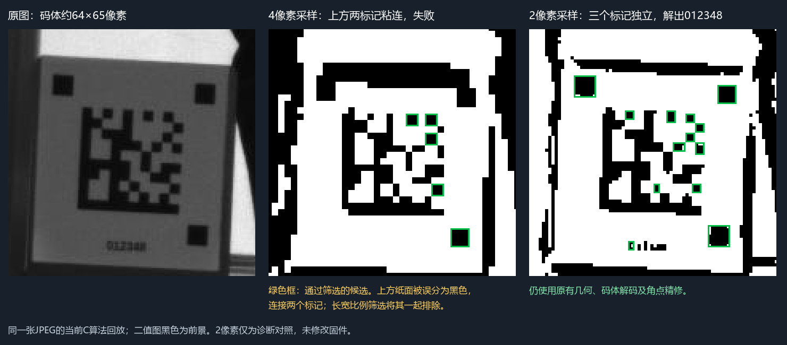

# 2026-11-18 captures 解码失败诊断

检查目录：`C:\Users\jq163\Downloads\captures`，共 5 张 1280×720 JPEG 及其 5 份 JSON。
现已将原JPEG、原JSON及用于回归的同名PNG、Gray8归档至 `docs/failure_diagnosis/` 根目录，来源和哈希见 `import_manifest.json`。Gray8由JPEG解压生成，不是原始CSI数据。
初始诊断回放代码基线：`3f7d372`。后续已完成固件修复、烧录及现场耗时测试，见 [板端实测](BOARD_TEST.md)。

## 结论

五张图片共同失败在**三个外部实心方块的定位阶段**。当前局部二值化在亮背景与暗纸面交界处，把上沿纸面判为黑色，将左上、右上两个方块连成一个长条；长宽比过滤随后排除这个连通域，无法组成三标记定位。码体本身可读。

## 逐图结果

帧号是抓图记录中的内部序号，不是 UART 协议中的 0～999 帧号。

| 抓图帧号 | 记录中的 P4 耗时 | 记录结果 | 当前 C 算法默认回放 | 同算法 2 像素采样 | 独立 ZXing |
|---|---:|---|---|---|---|
| 56657 | 31.312 ms | 失败 | 标记定位失败 | 012348 | 012348 |
| 56676 | 16.203 ms | 失败 | 标记定位失败 | 012348 | 012348 |
| 56694 | 24.280 ms | 失败 | 标记定位失败 | 012348 | 012348 |
| 56713 | 32.580 ms | 失败 | 标记定位失败 | 012348 | 012348 |
| 56730 | 24.624 ms | 失败 | 标记定位失败 | 012348 | 012348 |

默认回放使用当前两阶段准备接口及 6 像素搜索、4 像素失败重试路径；五张的归一化、码体解码、角点精修计时均为零。2 像素对照仍使用原有后续算法，五张均解出 10×10 模块的 DataMatrix，且 `geometry_quality=2`，完成角点精修。3 像素对照五张仍失败，因此不能认为简单改成 3 像素就足够。

## 直接证据

码体约 64×65 像素，三个外部方块约 12～14 像素。标记完整入画，未发现严重遮挡或裁切。

4 像素网格中，上方两个标记在五张图里均属于**同一个**连通域：左上坐标 `(540,256)`，网格包围框换算到原图约 `100×28` 像素（25×7 个采样点）。右下标记则保持独立，约 12×12 像素。

当前二值化使用 13×13 采样点的局部均值，将低于均值 75% 的像素归为黑色。4 像素步长对应约 52 像素的邻域，标签上方亮背景进入邻域，抬高阈值。例如首图纸面点 `(580,264)` 的灰度为 80，采样邻域均值为 121.66，判黑阈值为 91.24，因此该纸面点被判成黑色。纸面与黑色方块在二值图中粘连。

临时诊断日志显示，首图该连通域有 101 个采样点，经原图灰度复核后仍有 93 点，包围框不变；后续要求短边/长边至少为 0.6，而该域为 `7/25=0.28`，因此被排除。**失败发生在实心方块候选筛选阶段，尚未进入后面的标记对比度探针、三标记几何与纠错解码。**

2 像素网格把局部邻域缩小到约 26 像素，同时增加标记内部与周围间隙的采样点。三个标记恢复为独立连通域，首图包围框分别为 `(538,264,14,14)`、`(628,270,12,12)`、`(622,358,14,14)`，五张均通过后续解码。

## 建议处理方向

1. 优先解决亮暗交界处的二值化粘连：局部窗口应考虑原图像素尺度，并对疑似粘连区域以更细采样、多个局部阈值重新提取方块。
2. 保留快速搜索，在当前帧失败时触发有预算限制的细搜索；若做局部复核，区域应由当前帧候选产生，不依赖上一帧位置。
3. 不宜直接把全图长期固定为 2 像素：相对 4 像素，采样点从 57,600 增至 230,400，约 4 倍；对板端耗时、内存及上传并行影响需要另行实测。
4. 现场可先让标签表面照明更均匀，减少紧邻上沿的强亮背景影响；软件仍需处理这种场景。

## 验证边界与文件

此次输入是保存的 JPEG，经解压得到灰度图，并非原始 CSI RAW8。当前 C 回放复现了全部失败，并通过采样对照定位到共同故障；JPEG 压缩仍可能改变少量边缘像素。最终修复应补充板端原始帧与现场验证，主机回放时间不代表 ESP32-P4 时间。

- `evidence.json`：逐图原记录摘要、ZXing 结果、25 次 C 算法回放及连通域测量。
- `marker_comparison.png`：首图原图、4 像素失败二值图及 2 像素成功对照。
- 临时回放、灰度图与仪器化 C 源码保存在 `build/captures_20261118/`，不进入产品构建。
